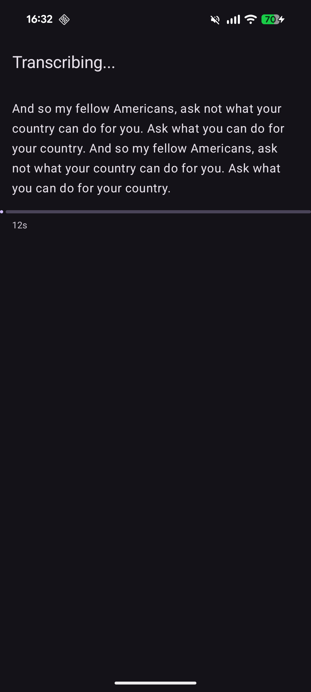
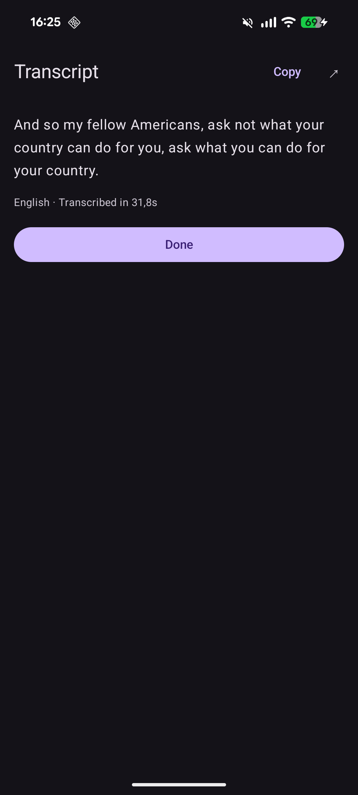
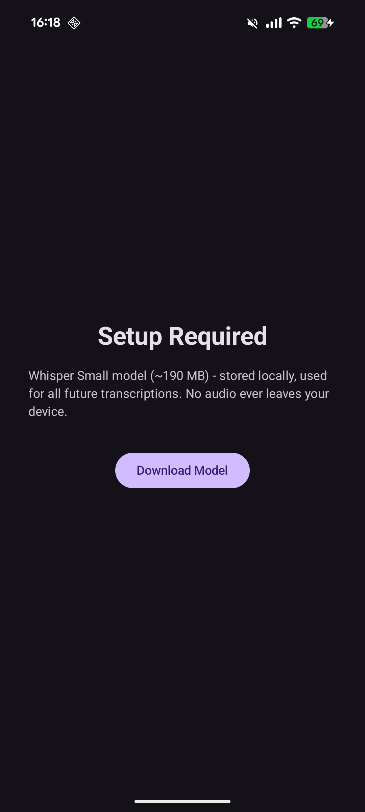

# Unyap

Read any voice note. Unyap is an Android app that transcribes voice notes to text entirely on your device, using [whisper.cpp](https://github.com/ggerganov/whisper.cpp). No audio or text ever leaves your phone.

## How it works

1. Share a voice note (e.g. from WhatsApp) to Unyap, or pick an audio file in the app
2. Words stream in as they are transcribed
3. Select, copy, or share the transcript

On first launch, Unyap downloads the Whisper Small model (~190 MB) once. After that, the app never makes a network request.

## Screenshots

<table>
  <tr>
    <td align="center"><br><sub>Words stream in as they decode</sub></td>
    <td align="center"><br><sub>Copy or share the result</sub></td>
    <td align="center"><br><sub>One-time model download</sub></td>
  </tr>
</table>

## Features

- Share target for any `audio/*` file, plus an in-app file picker
- Real-time streaming as each segment is decoded
- Automatic language detection (German, English, and 90+ others)
- Select and copy any part of the transcript
- Share the transcript as plain text to any app
- On-device only: the sole network request is the one-time model download
- Tuned for ARM: NEON, dotprod, and i8mm instructions
- Roughly real-time on a recent phone (~15s of audio in ~15s on a Pixel 8)

## Privacy

The only time Unyap touches the network is the one-time model download from Hugging Face. Audio decoding, transcription, and the resulting text all stay on the device. The app requests only the `INTERNET` permission, used solely for that download.

## Building

Requires Android Studio with the NDK and CMake installed. Build with **JDK 21** (the JetBrains Runtime bundled with Android Studio); newer JDKs are not yet supported by the Gradle/AGP versions used here.

```bash
git clone --recurse-submodules https://github.com/FelixGerberding/unyap.git
cd unyap

export ANDROID_HOME=~/Android/Sdk
export JAVA_HOME=/opt/android-studio/jbr
./gradlew assembleDebug
```

If you cloned without `--recurse-submodules`, fetch whisper.cpp with:

```bash
git submodule update --init --recursive
```

The target ABI is `arm64-v8a` only.

### Release builds

Release signing credentials are kept out of version control. To build a signed release, copy `keystore.properties.template` to `keystore.properties` (gitignored) and fill in your keystore details. Without it, the project still configures and builds (unsigned).

## Tech stack

- Kotlin + Jetpack Compose
- whisper.cpp via JNI, running on the CPU with a quantized `q8_0` model
- `MediaCodec` for audio decoding (no external audio libraries)
- Min SDK 29 (Android 10), target SDK 35

## Project structure

```
app/src/main/
  cpp/
    jni_bridge.cpp            JNI bridge to whisper.cpp
    whisper.cpp/              git submodule
  java/codes/felix/whisp/
    TranscribeActivity.kt     Entry point, share-intent and file-picker handling
    audio/OpusDecoder.kt      MediaCodec audio decoder
    whisper/WhisperEngine.kt  Model management and streaming transcription
    whisper/WhisperResult.kt  Transcription result model
    ui/ModelDownloadScreen.kt One-time model download
    ui/TranscriptScreen.kt    Streaming transcription UI
```

## License

Released under the [MIT License](LICENSE).

Bundles [whisper.cpp](https://github.com/ggerganov/whisper.cpp) (also MIT) as a submodule, and downloads the Whisper model from [ggerganov/whisper.cpp on Hugging Face](https://huggingface.co/ggerganov/whisper.cpp) at runtime.
